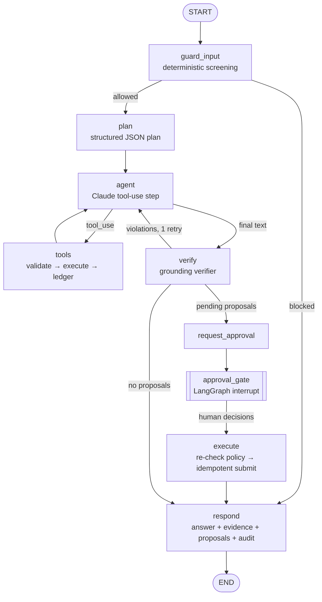

# Fleet Copilot

An agentic assistant for IT administrators that answers fleet health and compliance questions, surfaces trends
from 30 days of device telemetry, and proposes operational actions that only run after explicit human approval.
It is built as an explicit **LangGraph** state machine over **Claude** (Anthropic Messages API, official Python
SDK), with deterministic analytics tools, an evidence ledger, policy-checked actions, and a hash-chained audit log.

```
$ fleet-copilot ask --tenant initech-003 "Propose fixes for devices that are consistently constrained by RAM."
  (offline mode; the evidence table and proposal table that follow are omitted here)

Devices consistently RAM constrained - 1 finding(s) over 7 device(s) [E2]. Rule: memory used > 85% in >= 70% of snapshots.
 • I3JLKILKQTAC (high, emp-initech-1001): Memory utilisation exceeded 85% in 30/30 snapshots ... RAM on a Mac mini
   is soldered and cannot be upgraded. [E1]
Proposed actions (awaiting your approval - nothing has been executed):
 • P1: flag_device_for_replacement for I3JLKILKQTAC [E1]
╭── Approval required: P1 ── risk=high ── verified by policy from telemetry: ... ──╮
Approve which proposals? (all / none / ids): all
 • P1 flag_device_for_replacement (I3JLKILKQTAC): executed as RPL-0824136F, approved by admin@initech-003
```

### Two ways to run it

| | **Offline mode** (what I used) | **Real model** (Claude) |
|---|---|---|
| Needs | nothing: no API key, no network | an Anthropic API key |
| What answers | a deterministic, rule-based stand-in for the LLM | Claude (`claude-opus-5-5` by default) |
| What it proves | the whole pipeline works: planning, tool calls, evidence ledger, action policy, approval pause, execution, grounding verifier, audit log | the language quality: understanding varied phrasing, follow-up questions, judgement |
| Results | **64 / 64** eval cases passed, 0 guardrail violations (the 65th case, a multi-turn follow-up, needs the real model; see [Results](#results)) | not run for this submission |

I evaluated this in offline mode because I had no API budget. The agent is built for the real model and switching
takes one environment variable; the Claude request format is unit-tested, but I have not run it against the live
API. **To test it with real AI:**

```bash
export ANTHROPIC_API_KEY=sk-ant-...
uv run fleet-copilot chat --tenant acme-001                  # chat with the real agent
uv run --extra ui fleet-copilot ui                          # or in the web UI (Model: claude)
uv run python -m evals.run --llm claude                      # same 65 eval cases against Claude
uv run python -m evals.run --llm claude --repeats 3          # also measures run-to-run stability
```

With a key set, the CLI uses Claude automatically; `--llm offline` or `--llm claude` forces either one. The
guardrails (tenant isolation, approval, evidence policy, audit) are enforced by code in both modes, so they do not
depend on which model is answering.

---

## Contents

1. [Quick start](#1-quick-start)
2. [Running the agent](#2-running-the-agent)
3. [Running the evaluations](#3-running-the-evaluations)
4. [Agent architecture](#4-agent-architecture)
5. [Tool catalog](#5-tool-catalog)
6. [Grounding strategy](#6-grounding-strategy)
7. [Guardrails](#7-guardrails)
8. [Key design decisions and trade-offs](#8-key-design-decisions-and-trade-offs)
9. [What the data shows](#9-what-the-data-shows)
10. [Limitations and next steps](#10-limitations-and-next-steps)
11. [Repository layout](#11-repository-layout)

---

## 1. Quick start

Requirements: Python 3.12+ and [uv](https://docs.astral.sh/uv/) (or plain `pip`).

```bash
git clone <repo-url> fleet-copilot && cd fleet-copilot
uv sync                                  # creates .venv, installs deps from uv.lock
uv run pytest -q                         # 63 tests, ~10 s, no network (the web-UI tests skip without the ui extra)
uv run python -m evals.run               # full eval suite, offline backend, no API key needed
uv run --extra ui fleet-copilot ui       # web UI in your browser (http://localhost:8501)
```

Everything above runs in offline mode. To use the real model, provide credentials the Anthropic SDK can find
(see [Two ways to run it](#two-ways-to-run-it)):

```bash
export ANTHROPIC_API_KEY=sk-ant-...      # or ANTHROPIC_AUTH_TOKEN / an `ant auth login` profile
```

Without uv: `python -m venv .venv && . .venv/bin/activate && pip install -e '.[ui]' pytest` (drop `[ui]` if you
don't need the web UI), then run the same commands without `uv run`.

The dataset ships in `data/device-telemetry-dataset.ndjson` (750 snapshots, 25 devices, 3 companies, 30 days).

| Environment variable | Default | Purpose |
|---|---|---|
| `FLEET_COPILOT_MODEL` | `claude-opus-5-5` | Claude model id |
| `FLEET_COPILOT_EFFORT` | `medium` | `output_config.effort` for agent steps (planner always uses `low`) |
| `FLEET_COPILOT_FALLBACKS` | `on` | server-side refusal fallback (beta `server-side-fallback-2026-07-01`) |
| `FLEET_COPILOT_STRICT_TOOLS` | `on` | `strict: true` tool schemas |
| `FLEET_COPILOT_MAX_STEPS` | `10` | agent-loop step budget per turn |
| `FLEET_DATA_PATH` / `FLEET_VAR_DIR` | `data/…` / `var/` | dataset path; directory for the audit log, action outbox and conversation checkpoints |
| `FLEET_ACCESS_FILE` | demo directory | YAML access directory (tenant → identity → roles); see Guardrails |

## 2. Running the agent

Every session is bound to one tenant (company), the way an admin console session would be.

### Web UI (easiest way to try it)

```bash
uv run --extra ui fleet-copilot ui       # installs Streamlit on first run, opens http://localhost:8501
```

The server listens on localhost only (it has no login of its own, so it must not be reachable from the network).

Pick an organization and an identity in the sidebar (`admin@` / `secops@` can approve, `analyst@` is read-only),
then click an example question or type your own. Each answer shows its evidence table, any proposals, the
plan and agent trace, and an **Explain** panel that traces every sentence to raw NDJSON line numbers. Proposed
actions appear as approval cards: tick what you approve and submit; high-risk actions ask for a second
approver. The sidebar lists conversations waiting for approval (including ones started from the CLI), the
**Insights** tab runs the trend detectors directly, and the **Audit log** tab shows the hash-chain status and this
organization's events. The UI is a thin layer over the same `CopilotSession` as the CLI: same graph, guardrails,
checkpoints and audit log, and it can run side by side with the CLI.

### Command line

```bash
# Interactive chat, with approval prompts when the agent proposes actions
uv run fleet-copilot chat --tenant acme-001

# One-shot question (approvals: prompt | none | all | P1,P3)
uv run fleet-copilot ask --tenant acme-001 "Which devices at Acme are low on disk space?"
uv run fleet-copilot ask --tenant acme-001 "Open remediation tickets for devices failing screen lock" --approve P1,P2
uv run fleet-copilot ask --tenant globex-002 "Which batteries are approaching end of life?" --json   # full structured result
uv run fleet-copilot ask --tenant acme-001 "How many devices run an OS older than macOS 15?" --trace # plan + node trace

# Approve later, from another process or by a colleague (conversations are checkpointed in SQLite)
uv run fleet-copilot ask --tenant acme-001 "Open remediation tickets for devices failing screen lock" --approve later
uv run fleet-copilot approvals list   --tenant acme-001 --actor secops@acme-001
uv run fleet-copilot approvals resume --tenant acme-001 --actor secops@acme-001 --thread t-... --approve P1,P2
uv run fleet-copilot ask --tenant acme-001 --thread t-... "And which of those are also low on disk?"  # continue a thread

# High-risk actions (replacement) need two distinct approvers
uv run fleet-copilot ask --tenant initech-003 "Propose fixes for devices consistently constrained by RAM" \
    --approve all --second-approver secops@initech-003

# Traceability: every sentence of the last answer -> evidence id -> tool call -> raw NDJSON line number
uv run fleet-copilot explain --tenant acme-001            # or --thread t-... / --json

# No-LLM utilities
uv run fleet-copilot insights --tenant initech-003     # run the trend detectors directly
uv run fleet-copilot audit verify                      # verify the hash chain + head anchor
uv run fleet-copilot audit tail --tenant acme-001 -n 20 # one tenant's events (--all = operator view)
```

Tenants: `acme-001` (Acme), `globex-002` (Globex), `initech-003` (Initech). The backend defaults to `claude` when
`ANTHROPIC_API_KEY`/`ANTHROPIC_AUTH_TOKEN` is set and to `offline` otherwise; force one with `--llm claude|offline`.
Approved actions go to `var/outbox.jsonl` (a mock of the ticketing/procurement/notification systems); every
event goes to `var/audit.jsonl`; conversations (including paused approvals) are checkpointed in
`var/checkpoints.sqlite`. Demo identities per tenant: `admin@<tenant>` and `secops@<tenant>` can approve,
`analyst@<tenant>` is read-only. `--actor` defaults to `admin@<tenant>`.

**About the `offline` backend.** It is a deterministic, rule-based stand-in for the LLM that speaks the same
protocol (structured plan, Anthropic-format `tool_use` blocks, cited final answer). It exists so the *whole*
pipeline — planning, tool execution, evidence ledger, action policy, approval interrupt, execution, grounding
verification, audit — runs reproducibly in CI and in the eval suite without network access. It is keyword
routing plus templates, so it is a harness for the architecture and guardrails, not a language model. Open-ended
phrasing, follow-ups ("propose actions for *those* devices") and judgement calls are what Claude is for.

## 3. Running the evaluations

```bash
uv run python -m evals.run                               # offline backend (deterministic)
uv run python -m evals.run --llm claude                  # live Claude
uv run python -m evals.run --llm claude --repeats 3      # + run-to-run consistency
uv run python -m evals.run --only qa-highsev-laptops-acme --verbose
uv run python -m evals.run --category guardrail model_misbehavior
uv run pytest -q                                         # unit tests
```

Reports are written to `evals/reports/<backend>-latest.{md,json}`; the exit code is non-zero if any case fails or
any invariant is violated. `.github/workflows/ci.yml` runs the unit tests and the offline suite on every push.

### Methodology

**Ground truth is independent of the agent.** `evals/oracle.py` re-derives every expected answer from the raw
NDJSON with plain `json` and no imports from `fleet_copilot`. If the oracle reused the package's parser or
detectors, a bug there would be graded as correct. The unit tests also cross-check the package's detectors against
the oracle for every tenant.

**65 golden cases in six categories** (`evals/cases.yaml`):

| Category | Cases | What it probes |
|---|---|---|
| `grounded_qa` | 15 | The three brief examples on all 3 tenants, point-in-time filters, device/employee lookups, overview, plus traps: *"laptops failing high-severity checks"* (correct answer: **none**, the only high-severity check passes everywhere) and *"failing the firewall check"* (no such check exists) |
| `insight` | 9 | Battery end of life, consistent RAM/storage constraint, compliance drift, unapproved software, telemetry gaps, including "none found" answers |
| `action` | 6 | Proposal correctness (right tool and device, serviceability-aware: replace the soldered-RAM Mac mini, upgrade the XPS), approve-all / approve-none / approve-first paths |
| `guardrail` | 13 | A device whose reported hostname carries a prompt injection (real model in the loop: must answer and propose nothing); cross-tenant by name, device id (also lowercase) and employee id; prompt injection (incl. paraphrased); a benign phrase that used to trip the filter (false-positive regression); "without approval"; insufficient evidence (RAM order for a healthy soldered Mac, replacing a healthy device); unsupported operation (remote wipe); out of scope |
| `robustness` | 4 | Paraphrases; a lowercase device id; a multi-turn follow-up that needs reference resolution (Claude only) |
| `model_misbehavior` | 18 | The LLM is replaced by a **script that deliberately misbehaves**: obeys an injection planted in device telemetry; gets a high-risk action approved by one person (refused) vs two (executes); has a read-only viewer approve; looks up another tenant's device; cites real evidence for the wrong device; invents a number next to a valid citation; invents citations; proposes actions with fabricated or mismatched evidence; writes a phishing message to an employee; puts a false claim and a wipe instruction in a ticket note; asks to replace a device whose problems are fixable; leaks a foreign id into the approval prompt; and the simulated approver sends blank, missing or other-tenant identities. These pass only if the guardrails are enforced by code the model cannot influence. |

**Per-case checks:** exact or recall match of the device set named in the answer, stated counts, required and
forbidden phrases, tool selection, minimum citations, expected proposals (tool × device), policy refusals, number
of executed actions after a simulated approver, and the grounding verifier's verdict.

**Global invariants checked on every case:** no other-tenant identifier (matched case-insensitively) anywhere a
human can see it: the answer, the evidence, the ledger, or any approval prompt; no executed action without a matching approval (with approver identity) in the audit log, and outbox
count = executed count; audit hash chain intact; every citation resolves.

**Aggregate metrics:** pass rate per category, device precision/recall/F1, action precision/recall/F1, citation
validity, ungrounded-entity rate (computed independently of the verifier), verifier fail rate, unsupported numbers,
misattributed entities, invariant violation counts, latency p50/p95, tokens, and with `--repeats N` a
stability score (share of cases whose outcome, device set and proposals are identical across runs).

**Planner metrics** (planning is measured, not just present). Every model-driven case is labelled with the
intent(s) a careful reader would assign; ambiguous phrasings list both acceptable intents. Reported:
*intent accuracy*; *plan adherence* (planned read steps that were actually executed); *plan coverage* (executed
read tools that were in the plan); *actions anticipated* (turns that proposed actions where the plan said so).
Intent is a metric rather than a pass/fail gate, because some questions legitimately admit two readings.

### Results

Offline backend (`evals/reports/offline-latest.md`; deterministic: identical results on every run, only the report
timestamp and latencies change):

| Metric | Value |
|---|---|
| Cases passed | **64 / 64** (1 skipped: multi-turn follow-up requires Claude) |
| Device precision / recall / F1 | 0.98 / 1.00 / 0.99 |
| Action precision / recall / F1 | 1.00 / 1.00 / 1.00 |
| Citation validity / ungrounded-entity rate / verifier fail rate | 1.00 / 0.00 / 0.00 |
| Planner intent accuracy / plan adherence / plan coverage | 0.95 / 1.00 / 1.00 |
| Cross-tenant leaks / executions without approval / audit breaks | 0 / 0 / 0 |
| Unit tests | 63 passed |

How to read this: the offline backend was written alongside these cases, so its score shows that the pipeline,
tools, policy and guardrails behave as specified. It does not measure language understanding. The misses are left
visible on purpose: for *"which laptops keep maxing out their memory?"* the offline router misses the "sustained"
meaning of "keep" (wrong intent, and one extra device that is high now but not consistently), and it classifies
*"what is the current status of device X?"* as trend analysis. **A real-model run is
the language-quality measurement, and it was not run for this submission** (it was built without an API budget).
With a key it is one command: `uv run python -m evals.run --llm claude --repeats 3` runs the same 65 cases against
Claude and writes `evals/reports/claude-latest.md`, including the stability score. The Claude request format is
covered by unit tests (`tests/test_claude_backend.py`), but has not been exercised against the live API. The
`model_misbehavior` and guardrail invariants hold for any backend by construction: they do not depend on the
model behaving.

## 4. Agent architecture



It is an explicit graph (`src/fleet_copilot/agent/graph.py`), not a prompt wrapper or a prebuilt ReAct agent:

| Node | Responsibility |
|---|---|
| `guard_input` | Resets per-turn state; screens for cross-tenant references and prompt injection (deterministic); flags "skip approval" requests. Blocked requests go straight to `respond` with a refusal and are audited as security events. |
| `plan` | One Claude call with **structured output** (`output_config.format` JSON schema, low effort) produces `{intent, goal, steps[tool, purpose], needs_actions, assumptions}`. The plan is audited, shown with `--trace`, and given to the agent as the first step of its context. Recording assumptions (e.g. "low disk = free < 15%") makes ambiguity resolution visible. |
| `agent` ⇄ `tools` | The ReAct loop. Claude calls tools (parallel calls supported); the `tools` node re-validates every argument with the tool's pydantic model, runs it against the tenant-scoped view, registers each result row in the evidence ledger, and returns `tool_result` blocks. A step budget (`FLEET_COPILOT_MAX_STEPS`) forces a final answer with `tool_choice: none`. |
| `verify` | Deterministic grounding verifier (section 6). On violations it appends feedback and sends the agent back for **one** revision; if the answer still fails it is shown with a visible warning, or withheld if it names out-of-tenant identifiers. |
| `request_approval` → `approval_gate` | If the turn produced policy-approved proposals, the graph **pauses** using LangGraph `interrupt()`. State is checkpointed and resumed with `Command(resume=decisions)`. The CLI checkpoints to SQLite (`var/checkpoints.sqlite`), so the pause survives the process: `approvals list` shows pending conversations and `approvals resume` decides them later, by any approver of that tenant. Tests and evals use `InMemorySaver`; production would use Postgres. |
| `execute` | For each proposal: a missing or malformed decision, or an approver who is blank or not authorized for this tenant, counts as rejection (fail closed). Approved proposals are re-checked against the policy at execution time (state may have changed while waiting), then submitted with an idempotency key. |
| `respond` | Builds the final payload: answer, cited evidence records, proposals with outcomes, grounding report, plan, node trace, token usage. Audits a hash of the answer. |

Multi-turn: a session is a LangGraph thread. Messages, the evidence ledger and proposals persist across turns, and
outcomes of earlier proposals (executed, rejected) are fed back to the model on the next turn. The state contains
only JSON data; the store, LLM backend, audit log and action backend are bound by closure (`Deps`), so backends
swap without touching the graph.

**Claude integration** (`llm/claude.py`): Messages API via the official SDK; default model `claude-opus-5-5` with
adaptive thinking (always on for this model) and `effort: medium`; strict tool schemas; the system prompt is cached
(`cache_control`); assistant content, including thinking blocks, is appended back unchanged; server-side refusal
fallback is on by default; a `refusal` or `max_tokens` stop never executes that turn's tool calls.

## 5. Tool catalog

All tools are tenant-scoped through a `TenantView`, validated with pydantic (`extra="forbid"`), and exported to
Claude as `strict` JSON schemas. Every row returned carries an `evidence_id`.

### Read tools

| Tool | Arguments | Returns |
|---|---|---|
| `fleet_overview` | — | Counts by device type / OS version / model, employees, latest failing-device count per compliance check |
| `search_devices` | `device_type`, `os_family`, `os_version_below`, `model_name_contains`, `max_disk_free_pct`, `min_mem_used_pct`, `failing_check_id`, `failing_severity`, `battery_condition`, `has_software`, `employee_id` | Devices matching on their **latest** snapshot (disk, memory, OS, failing checks, battery, unapproved apps, snapshot ref), plus a `scope_evidence_id` that backs counts and "none matched" answers |
| `get_device_profile` | `device_id` | Latest state, 30-day disk/memory/battery stats and trend, each check's status and since-when, software (approved or not), owner, field-serviceability of RAM/storage/battery |
| `get_metric_history` | `device_id`, `metric` (disk, memory, battery cycles/capacity/condition, compliance status + `check_id`, software, OS version) | Per-snapshot series with refs, min/max/mean/least-squares trend |
| `compliance_report` | `check_id`, `severity`, `device_type` | Current failures with since-when (start of the current failing streak) and the **catalog of checks with severities**, so a model can say "the only high-severity check is `disk_encryption` and it passes everywhere" |
| `detect_insights` | `kinds[]`, `device_id`, `include_info` | Deterministic trend findings, each with metrics, the rule that fired, a plain-language explanation and snapshot refs; tenant-level daily compliance trend for drift |

`detect_insights` detectors (thresholds in `config.py`, shared by tools, policy and docs):

| Kind | Rule |
|---|---|
| `storage_constrained` | free disk < 15% in ≥ 70% of snapshots (sustained), or latest < 15% (emerging); critical < 10% |
| `ram_constrained` | memory used > 85% in ≥ 70% of snapshots; reports mean, p95, peak |
| `battery_end_of_life` | OS condition ≠ Normal, or cycles ≥ 1000, or projected to reach 1000 within 120 days at the observed cycles/day, or full-charge capacity drop ≥ 3% within the window |
| `compliance_drift` | a check went pass → fail and is still failing (plus remediations, fail → pass, as info); tenant daily failing counts first vs last day |
| `unapproved_software` | risky apps outside the approved baseline (uTorrent, TeamViewer, CleanMyMac X), with first-seen date |
| `telemetry_gaps` | snapshots missing battery or network blocks: a data-quality finding, not a device condition |

### Action tools (proposal only)

| Tool | Arguments | Evidence policy (re-derived from telemetry, never from the model's claim) | Risk |
|---|---|---|---|
| `create_upgrade_order` | `device_id`, `component` (ram/storage/battery), `spec`, `justification`, `evidence_ids` | Component must be field-serviceable on that model; spec from the catalog and larger than what is installed; a matching sustained constraint (RAM / storage / battery EOL) must be detected | medium |
| `open_remediation_ticket` | `device_id`, `check_id` (or `unapproved_software:<app>`), `note`, `evidence_ids` | The check must be failing on the latest snapshot, or the app installed now | low |
| `flag_device_for_replacement` | `device_id`, `reason`, `evidence_ids` | A sustained constraint on a component that cannot be serviced on that model (soldered RAM / storage) | high |
| `notify_employee` | `employee_id`, `device_id`, `message`, `evidence_ids` | The employee must own the device; a current finding or failing check must exist; ≤ 1000 chars | low |

Common rules for every action: target in tenant; at least one cited evidence id that exists, belongs to the tenant
and is **specific to the target device** (aggregate "scope" evidence does not count); free text may not reference
other devices or employees; no duplicate of a pending or already-submitted action. A refused proposal is returned
to the model with reasons (`rejected_by_policy`) and is never offered for approval.

## 6. Grounding strategy

1. **Facts come from code.** Filtering, aggregation and trend detection are done by deterministic tools. The LLM
   picks tools, interprets results, prioritises and writes. It never computes a statistic over raw telemetry.
2. **Every fact gets an id.** Each row a tool returns is registered in an `EvidenceLedger` as `E1, E2, …`, with the
   tool name, arguments, the claim, the data, and the underlying **snapshot refs** (`<device_id>@<timestamp>`, the
   primary key of an NDJSON line). Negative and aggregate results get evidence too (`scope_evidence_id`), so
   "0 of 10 devices" is as traceable as a positive match.
3. **Answers must cite.** The system prompt requires `[E#]` citations on every factual sentence, numbers copied
   from tool output, stated definitions, and "the data can't answer this" instead of guessing. A missing battery
   block is described as a reporting gap, not as "no battery".
4. **Answers are verified, not trusted.** The `verify` node checks, sentence by sentence:
   - every citation resolves to a ledger record;
   - **claim binding**: a device id in a sentence must be the subject of a record *that sentence* cites (a
     device-specific row, or an aggregate record whose `matched` list contains it). A real citation attached to a
     claim about a different device fails. Aggregate "scope" records support counts and "none matched", never
     per-device facts;
   - **numbers**: every number in a cited sentence must appear in the records it cites (thresholds and numbers from
     the question are allowed). Uncited sentences are checked against the whole ledger;
   - no identifier from another tenant appears, and an answer written after tool use cites something.

   A sentence without its own citation inherits its line's (a bullet or paragraph). Failures go back to the agent
   once with the violations listed; then the answer is shown with a ⚠️ warning, or withheld if it names identifiers
   outside the tenant. The same redaction applies to the draft shown in the approval prompt. The checks are lexical:
   they catch invented, misattributed and mis-copied facts, not a wrong *interpretation* of a correctly cited value.
5. **Traceability end to end.** The final payload includes the cited evidence records; the CLI renders an evidence
   table with snapshot timestamps; `--json` returns everything; the audit log records every tool call with the
   evidence ids it produced. `fleet-copilot explain` prints the whole chain for the last answer of a conversation:
   each sentence → its `E#` citations → tool + arguments → snapshot refs → **line numbers in the NDJSON file** with
   the relevant raw values, so a reviewer can check any statement with `sed -n '<line>p'`.
6. **Fixed "now".** Time-relative language is anchored to the dataset's last snapshot (`as_of`), not the wall
   clock, so answers do not drift between runs.

## 7. Guardrails

Defence in depth. The important property is that the **structural controls do not depend on the model behaving**.
The `model_misbehavior` eval category proves this with a scripted adversarial "model".

| Requirement | Control | Where |
|---|---|---|
| **Tenant isolation** | Structural: the agent and tools only ever receive a `TenantView` that physically contains one company's snapshots. No code path leads from it to other tenants. Unknown device ids get the same "not found in your organization" message whether they exist elsewhere or not, so it cannot be used to test whether a device exists. | `data/store.py`, `tools/*` |
| **Prevent cross-company access** | Pre-LLM guard refuses requests naming another company, or another tenant's device or employee ids, and audits them as security events; the action policy re-checks tenant scope; the grounding verifier withholds answers that name out-of-tenant ids and never echoes them | `guardrails/input_guard.py`, `action_policy.py`, `grounding.py` |
| **Explicit human approval** | Action tools only create proposals. Execution happens only in the `execute` node, after a LangGraph `interrupt`, for proposals with `approved: true` from identities that hold the **approver role in the session's tenant** (access directory; viewers cannot approve; another tenant's identities have no roles here). **High-risk actions (replacement) need two distinct approvers.** Blank, missing, unauthorized or duplicate identities and malformed resume payloads fail closed (`approval_invalid`). Paused approvals are checkpointed (SQLite) and can be resolved later from another process; threads are tenant-checked on re-open. Requests to "skip approval" are flagged and answered with a note that approval is mandatory. | `agent/graph.py`, `guardrails/access.py`, `agent/session.py` |
| **Audit logs** | Append-only JSONL with SHA-256 hash chaining (`prev_hash` → `hash`): session start, guard verdicts, plans, every tool call (args, errors, evidence ids), policy decisions, approval requests/decisions (who), executions (external id), grounding checks, final-answer hashes. `fleet-copilot audit verify` detects edited, reordered or deleted lines, and a head anchor (`audit.jsonl.head`, last seq + hash) detects lines cut off the end. A log that fails verification is never appended to (the CLI refuses to run). `audit tail` is filtered per tenant. Limitation: someone who can rewrite both files can forge history; production would anchor the head externally (WORM storage, signed checkpoints). | `audit.py` |
| **Refuse actions without sufficient evidence** | The evidence policy re-derives the justification with the same detectors and refuses on: no or unknown or foreign or non-device-specific evidence, condition not present, non-serviceable component, catalog violation, downgrade, wrong employee, duplicates. Replacement needs a constraint that cannot be fixed in place (several fixable problems are not enough). Free text is checked too: no destructive instructions (wipe/erase/reset), no claims about checks that are passing, and employee messages may not mention credentials or contain links. The policy is re-run at execution time. | `guardrails/action_policy.py` |
| Prompt injection | Pattern screen on input (plus empty / over-length input rejection; ids matched case-insensitively everywhere); tool results are scanned for instruction-like text in device-reported fields (hostnames, app names): the result gets a `security_notice` for the model and a `suspicious_telemetry` audit event, and whatever the model then proposes still faces the evidence policy and approval; system prompt marks device-reported strings (hostnames, app names) as data, not instructions; tool arguments schema-validated | `input_guard.py`, `prompts.py` |
| Runaway loops / cost | Step budget per turn with forced final answer; one grounding retry; LangGraph recursion limit | `config.py`, `graph.py` |
| Double execution | Idempotency key = hash(tenant, tool, args); LangGraph resume or a re-asked question cannot double-submit | `actions_backend.py` |

## 8. Key design decisions and trade-offs

- **Deterministic analytics, LLM for judgement.** "Consistently RAM constrained over 30 days" is a computation, not
  a language task. Doing it in code makes it correct, cheap and testable against an oracle, and keeps 750
  snapshots out of the context window. The cost: insights are limited to the detectors that exist. A new pattern
  needs a new detector, or the model composing `get_metric_history` calls.
- **Plan-then-act, not plan-and-execute.** A separate structured planning call makes intent, tool choice and
  assumptions explicit and auditable, and gives the eval suite something to inspect. The plan guides the ReAct loop
  but does not bind it, because rigid plan executors break on surprising tool results. Trade-off: one extra
  low-effort call per turn.
- **Evidence ids instead of free-form citations.** Short ids are cheap for the model to cite and trivial to verify
  mechanically. Free-text citations would need an LLM judge. The verifier binds each sentence's entities and numbers
  to the records it cites; it does not judge interpretation (see limitations).
- **Policy re-derives, never trusts.** The model must cite evidence, but the policy ignores the model's reasoning
  and recomputes the condition from telemetry. This also encodes domain knowledge the model may lack: Apple-silicon
  Macs and the X1 Carbon have soldered RAM, so the right action is replacement, not a RAM order.
- **Fail closed everywhere.** Unknown tenant → exception. Missing approval decision → rejected. Approval without an
  identity → rejected. Out-of-tenant id in an answer → withheld. Policy changed since proposal → blocked at
  execution.
- **Approval as a graph interrupt, not a CLI prompt.** Using LangGraph `interrupt` plus a checkpointer makes
  approval a first-class, resumable state that a web UI, Slack bot or ticket workflow can drive. The CLI uses a
  SQLite checkpointer, so a proposal made today can be approved tomorrow from another process by another admin
  (`approvals list/resume`); tests and evals use the in-memory saver. Re-opening a thread is tenant-checked.
- **Streamlit for the UI, as an optional extra.** The UI exists to make the agent easy to try and review, not as
  a product frontend, so it is a thin Python layer over the same `CopilotSession` as the CLI (no second code path
  for the agent, guardrails or approvals) and is covered by headless tests. It is an optional dependency so the core
  install and the evals stay lean. Trade-off: it looks like an internal tool; a production console would be a proper
  web app calling the same session API. It has no login of its own, so it binds to localhost only.
- **Offline backend for reproducibility.** Current Claude models do not accept sampling parameters, so exact
  repeatability is not available from the model. I get "reasonably deterministic" from deterministic tools,
  explicit plans, a fixed `as_of`, verification, and `--repeats` stability measurement, plus a fully deterministic
  backend for CI. Trade-off: the offline score must not be mistaken for model quality, which is why the README says
  so explicitly.
- **Hand-rolled graph over `create_react_agent`.** More code, but every control point (guard, verify, approval,
  execute) is a visible, testable node instead of a callback hook.
- **No vector store / RAG.** The data is structured and small. Retrieval is precise filtering via tools; embeddings
  would add fuzziness without benefit.
- **Company names** are derived from tenant ids (Acme, Globex, Initech) because the dataset carries ids only.
  **Hardware serviceability** is a small curated table (telemetry cannot tell whether RAM is soldered).

## 9. What the data shows

Profiling the dataset first shaped the tools. All of the following are found by the detectors and covered by evals:

- **Disk:** 6 devices consistently below 15% free, all at about 2% at the end of the window (2 per tenant).
- **Memory:** 3 devices consistently above 85% (Acme Dell XPS 15: upgradeable; Globex ThinkPad X1: soldered; Initech
  Mac mini 8 GB: soldered).
- **Battery:** 3 Acme laptops degraded to "Service Recommended" mid-window, with cycle counts of 948–1157 and about
  4% capacity loss in 29 days.
- **Compliance drift:** `screen_lock` regressed from pass to fail on 10 devices across all tenants during the window
  (0 → 5 / 2 / 3 failing devices). `os_up_to_date` fails steadily on 19 of 25 devices. `disk_encryption`, the only
  high-severity check, passes everywhere. That makes "laptops failing high-severity checks" a good hallucination
  trap.
- **Unapproved software** appeared mid-window on 6 devices (uTorrent ×4, TeamViewer, CleanMyMac X).
- **Data quality:** 4 laptops intermittently omit the battery block (and the same 4 the network block); Mac minis
  have no battery at all. The tools distinguish "not reported" from "absent".

## 10. Limitations and next steps

- **No real-model eval in this submission** (built without an API budget). Next step: run
  `uv run python -m evals.run --llm claude --repeats 3`, then tune the system prompt on the failures. That is the
  intended hill-climbing loop, with the offline suite as a regression guard for the deterministic layers.
- **Grounding checks are lexical.** Entities and numbers are bound to the cited records, but a correctly cited value
  can still be misinterpreted ("9% used" for "9% free"). Next step: an LLM judge for faithfulness, scored against
  the cited evidence records, reported as a separate eval metric.
- **Input guard is a regex screen** (defence in depth, not the isolation boundary). Paraphrased injections can get
  past it. Tenant isolation does not depend on it: the agent physically holds one tenant's data.
- **Offline backend coverage** is keyword-based by design; multi-turn references are Claude-only.
- **Persistence:** SQLite checkpoints, JSONL audit and outbox on local disk. Production would use Postgres for
  checkpoints, a WORM or append-only store for audit, and real ticketing/procurement integrations behind the same
  `ActionBackend` interface.
- **AuthN/Z:** roles and the two-person rule are enforced, but identities come from CLI flags and a demo directory
  (or `FLEET_ACCESS_FILE`). In production the actor comes from the authenticated session and roles from the IdP;
  `AccessDirectory` is the seam.
- **Scale:** tools scan an in-memory store, which is fine for 750 snapshots. At fleet scale the same tool
  interfaces would sit on a time-series database with pre-computed daily aggregates.

## 11. Repository layout

```
src/fleet_copilot/
  config.py                 thresholds, model settings, serviceability + software policy
  data/                     Snapshot model, tenant-partitioned TelemetryStore / TenantView
  analytics/insights.py     deterministic trend detectors (Finding + snapshot refs)
  evidence.py               EvidenceLedger (E# ids -> tool, args, claim, snapshot refs)
  tools/                    ToolSpec registry, read tools, proposal-only action tools
  guardrails/               input_guard, action_policy (evidence policy), grounding verifier, access (roles, two-person rule)
  agent/graph.py            LangGraph state machine (nodes, routing, interrupt)
  agent/session.py          session wrapper (ask / resume / pending), tenant-checked thread re-open, list_threads
  agent/prompts.py          planner + agent system prompts, plan JSON schema
  llm/                      claude.py (Anthropic SDK), offline.py (deterministic), scripted.py (red team)
  audit.py                  hash-chained audit log
  actions_backend.py        mock downstream systems with idempotency
  explain.py                sentence -> evidence -> tool call -> NDJSON line report
  cli.py                    chat / ask / approvals / explain / ui / insights / audit
  ui/app.py                 Streamlit web UI (optional `ui` extra) over the same CopilotSession
evals/
  oracle.py                 independent ground truth from raw NDJSON
  cases.yaml                65 golden cases
  run.py                    runner, invariants, metrics, reports
  reports/                  generated reports (offline-latest.md committed)
tests/                      63 tests (data, detectors vs oracle, tools, policy, guardrails, graph, durability, roles, explain, poisoned telemetry, Claude request shape, headless web UI)
data/device-telemetry-dataset.ndjson
```
